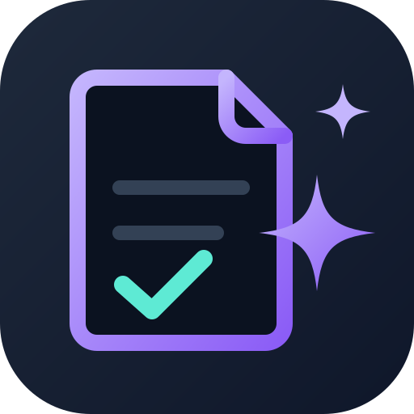

<p align="center">
  
</p>

# skill-generator

[](https://github.com/evrentan/skill-generator/actions/workflows/ci.yml)

An agent skill that creates new skills and updates, refactors, or improves existing ones, then proves they work by testing them with and without the skill.

It follows the open Agent Skills format (a folder with a `SKILL.md` plus optional bundled files), so it works in any agent harness that reads skills from folders such as `.agents/skills/`, `.claude/skills/`, `.devin/skills/`, or `.windsurf/skills/`.

## What it does

| You say | Mode |
|---|---|
| "Make me a skill for X", "turn this workflow into a skill" | **Create** |
| "Update / fix / improve this skill" (path, name, or pasted `SKILL.md`) | **Update** |
| "Why isn't my skill triggering?" | **Description tuning** |
| "Is v2 actually better than v1?" | **Evaluate** (blind A/B comparison) |

Create and Update share one loop:

1. Understand intent (interview, or mine the current conversation)
2. Draft or edit `SKILL.md` and bundled files
3. Validate structure with the bundled `scripts/quick_validate.py`
4. Run realistic test prompts with and without the skill
5. Grade and review results with the user
6. Improve and repeat
7. Tune the description so the skill triggers reliably

Update mode always snapshots the original first, audits it against best practices, applies minimal targeted edits, and shows a diff. Credential files (`secrets/`, `.env*`, `*.key`, `*.pem`) are never read, copied, or packaged.

## Requirements

- An agent tool that reads Agent Skills (Devin, Claude Code, Codex, Cursor,
  Windsurf, ...).
- Python 3.11 or newer for the bundled validator. It uses the standard
  library only and runs on macOS, Linux and Windows. On Windows, use `py -3`
  or `python` wherever this README says `python3`.

## Installation

### As a plugin (one command)

| Tool | Command |
| --- | --- |
| Claude Code | `/plugin marketplace add evrentan/skill-generator`, then `/plugin install skill-generator@skill-generator` |
| Devin | `devin plugins install evrentan/skill-generator` |
| OpenAI Codex | `codex plugin marketplace add evrentan/skill-generator`, then install `skill-generator` from `/plugins` |
| Cursor | Customize → Plugins → "From GitHub Repository" → `evrentan/skill-generator` |

Plugin installs namespace the skill as `/skill-generator:skill-generator` in
Claude Code and Devin.

### Manual install (any tool that reads Agent Skills)

Copy or symlink `skills/skill-generator` into your tool's skills folder.
`~/.agents/skills/` is read by Codex, Cursor and Devin; `~/.claude/skills/` is
read by Claude Code.

```bash
# bash/zsh, from a clone of this repo
mkdir -p ~/.agents/skills
cp -R skills/skill-generator ~/.agents/skills/
# or symlink, so a git pull updates the installed skill
ln -s "$(pwd)/skills/skill-generator" ~/.agents/skills/skill-generator
```

```powershell
# PowerShell, from a clone of this repo
New-Item -ItemType Directory -Force "$HOME\.agents\skills" | Out-Null
Copy-Item -Recurse skills\skill-generator "$HOME\.agents\skills\"
# or symlink (needs Developer Mode or an elevated prompt)
New-Item -ItemType SymbolicLink -Path "$HOME\.agents\skills\skill-generator" -Target "$PWD\skills\skill-generator"
```

## Usage

Just ask your agent in plain language; the skill triggers on requests to create, write, scaffold, update, fix, improve, refactor, merge, split, review, or benchmark a skill:

- "Turn what we just did into a reusable skill."
- "My `release-notes` skill keeps skipping the changelog step, can you fix it?"
- "My pdf skill never triggers, tune the description."

To invoke it explicitly, use `/skill-generator` (manual install) or
`/skill-generator:skill-generator` (plugin install in Claude Code and Devin).

### Validator

The bundled validator checks any skill folder for frontmatter errors, naming rules, description length and quality, body size, broken or orphaned file references, and credential-like files. It uses only the Python standard library (PyYAML is used if installed). The skill runs it for you; to run it yourself from a clone of this repo:

```bash
python3 skills/skill-generator/scripts/quick_validate.py <path-to-skill>
```

Errors exit with code 1; warnings are informational.

## Repository layout

```
skill-generator/
├── plugin.json               Agent Plugins manifest (read by Devin)
├── .claude-plugin/           Claude Code plugin + marketplace manifests
├── .codex-plugin/            OpenAI Codex plugin manifest
├── .agents/plugins/          OpenAI Codex marketplace manifest
├── .cursor-plugin/           Cursor plugin + marketplace manifests
├── .github/                  CI, issue and pull request templates, Dependabot
├── tools/
│   └── check_release.py      CI check: manifest versions and LICENSE copy in sync
├── assets/
│   ├── logo.svg              README logo and Codex composer icon
│   └── logo.png              Codex and Cursor plugin card logo
├── README.md, CHANGELOG.md, CONTRIBUTING.md, SECURITY.md, LICENSE
└── skills/
    └── skill-generator/
        ├── SKILL.md          skill instructions (entry point)
        ├── LICENSE           Apache-2.0, kept in sync with the root LICENSE
        ├── agents/
        │   ├── grader.md             grade assertions against run outputs
        │   ├── comparator.md         blind A/B comparison of two outputs
        │   └── analyzer.md           explain why a version won; benchmark patterns
        ├── references/
        │   ├── skill-format.md       frontmatter, structure, portability, audit checklist
        │   └── schemas.md            evals.json, grading.json, benchmark.md, trigger_evals.json
        └── scripts/
            └── quick_validate.py     structural validation of a skill folder
```

## Contributing

See [`CONTRIBUTING.md`](CONTRIBUTING.md) for the guide,
[`CHANGELOG.md`](CHANGELOG.md) for release notes and
[`SECURITY.md`](SECURITY.md) for reporting vulnerabilities.

## License

Apache License 2.0, see [LICENSE](LICENSE). Adapted from Anthropic's [`skill-creator`](https://github.com/anthropics/skills/tree/main/skills/skill-creator) skill.
